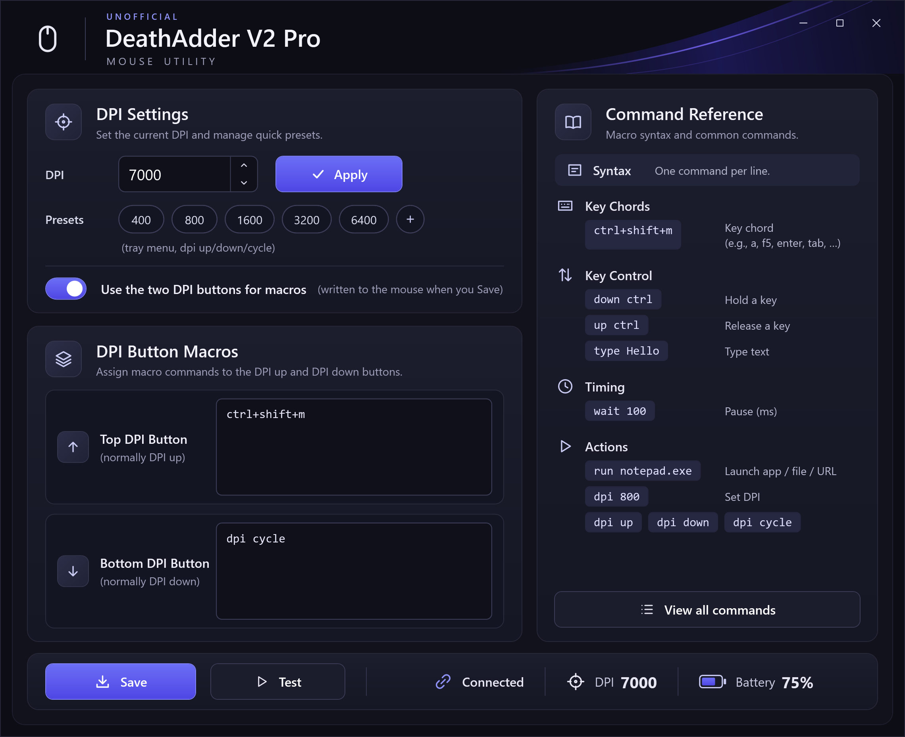
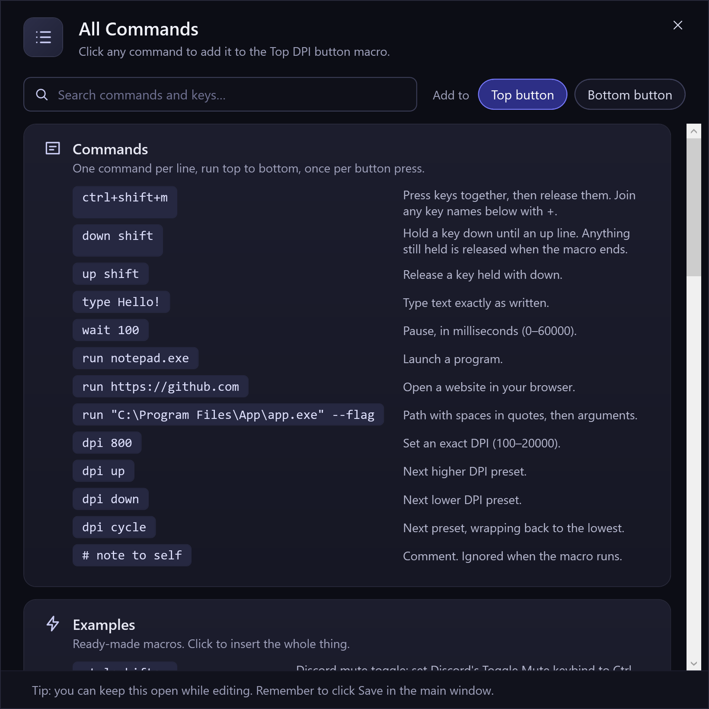

# DeathAdderTool (unofficial)

A tiny Windows tray app for the **Razer DeathAdder V2 Pro** that turns the two **DPI buttons** behind the scroll wheel into **macro buttons**, and lets you **change DPI** without Razer Synapse.



- **Macro buttons:** key combos, typing text, launching apps or websites, media keys, DPI switching
- **DPI control:** set any DPI from 100 to 20000, one-click presets in the window and the tray menu
- **Battery level** for the wireless dongle
- **No Synapse, no account, no background services.** About 13 MB of memory while idle in the tray.
- Searchable list of every command, with click-to-insert

> **Unofficial.** Not affiliated with or endorsed by Razer Inc. "Razer" and "DeathAdder" are trademarks of Razer Inc.

---

## Install

**Requirements:** Windows 10 or 11 (64-bit), and a DeathAdder V2 Pro on its wireless dongle or USB cable.

Download from the [Releases](../../releases) page:

| File | What it is |
|---|---|
| `DeathAdderTool-Setup-x.y.z.exe` | **Recommended.** Installs for your user account (no admin needed) with everything included. Adds a Start-menu entry and can start with Windows. |
| `DeathAdderTool-portable-x.y.z.zip` | No install: unzip anywhere and run `DeathAdderTool.exe` (about 0.35 MB). Needs the [.NET 8 Desktop Runtime (x64)](https://dotnet.microsoft.com/download/dotnet/8.0). **Before deleting it**, run `DeathAdderTool.exe --restore` (or untick the macro option and click Save), or your DPI buttons stay remapped. |
| `SHA256SUMS.txt` | Checksums of the files above, to verify your download (`Get-FileHash <file>` in PowerShell). Each release is built by GitHub Actions with a [build provenance attestation](../../attestations). |

Windows SmartScreen may warn about an unknown publisher because the exe isn't code-signed. Click **More info → Run anyway**.

**Close Razer Synapse first** (or uninstall it). Synapse rewrites the mouse's button mapping and will undo this app's remap.

### Supported hardware

| Device | USB ID |
|---|---|
| DeathAdder V2 Pro on the wireless HyperSpeed dongle | `1532:007D` |
| DeathAdder V2 Pro on the USB cable | `1532:007C` |

Other Razer mice aren't supported because their button IDs are different.

---

## Using it

Launching the app opens the settings window, and a blue mouse icon appears in the system tray (it may be hidden under the **^** arrow). **Closing the window keeps the app running in the tray. That's what makes the buttons work.** To stop it, right-click the tray icon and choose **Exit**.

- **Right-click** the tray icon to see DPI and battery, pick a DPI preset, toggle *Start with Windows*, or exit.
- **Left-click** the tray icon (or launch the app again) to open the settings window.

### What each control does, and when

| Control | Takes effect |
|---|---|
| **DPI** box + **Apply** | Immediately. Sets the mouse's DPI (100–20000). |
| **Preset pills** (400, 800…) | Clicking one sets that DPI immediately. **+** adds the DPI in the box as a preset; right-click a pill to remove it. Changes to the list are kept when you click **Save**. |
| **Use the two DPI buttons for macros** | On **Save**. When on, the mouse is set to send <kbd>F23</kbd>/<kbd>F24</kbd> from those buttons and the app runs your macros. When off, the factory DPI up/down function comes back. |
| **Top / Bottom DPI button** boxes | On **Save**. The macro for each button. |
| **Test** | Runs the macro box you last clicked in, after 1.5 seconds, so you have time to click into the app you want to test in. It doesn't need Save. |
| **View all commands** | Opens a searchable list of every command, key name and example. Click one to add it to the Top or Bottom macro. Commands in the main window's reference are clickable too. |

If you close the window with unsaved changes, it asks whether to save them.

### Macro syntax

One command per line, run top to bottom, **once per button press**:

| Command | Example | Does |
|---|---|---|
| *key chord* | `ctrl+shift+esc` | Presses the keys together, then releases them |
| `down` / `up` + key | `down shift` … `up shift` | Holds a key down / releases it. Anything still held is released automatically when the macro ends. |
| `type` | `type gg wp` | Types text exactly as written |
| `wait` | `wait 150` | Pauses (0–60000 ms) |
| `run` | `run notepad.exe` · `run https://github.com` · `run "C:\Tools\my app.exe" --flag` | Launches a program, file or URL |
| `dpi` | `dpi 800` · `dpi up` · `dpi down` · `dpi cycle` | Changes DPI (up/down/cycle step through your presets) |
| `#` | `# comment` | Ignored |

**Key names:** letters, digits, `f1`–`f24`, `enter`, `tab`, `esc`, `space`, `backspace`, `delete`, `home`, `end`, `pgup`, `pgdn`, `up`, `down`, `left`, `right`, `ctrl`, `shift`, `alt`, `win`, `printscreen`, `volup`, `voldown`, `mute`, `playpause`, `next`, `prev`, `stop`, numpad keys, punctuation (`oemminus` = `-`, `oemcomma` = `,` …) and browser keys. **View all commands** in the app lists every one.

**Good to know**
- `up` or `down` on its own line means the arrow key; `up shift` / `down shift` hold and release a key.
- There's no "while the button is held" mode yet. A macro runs once when you press the button.
- `dpi up` / `dpi down` / `dpi cycle` use your preset list.
- Macros are checked when you click **Save**. A mistake shows a message naming the line.

**Examples**

```text
# Discord mute toggle: set Discord's "Toggle Mute" keybind to Ctrl+Shift+M
ctrl+shift+m
```

```text
# Sniper button: drop to 400 DPI (put "dpi 1600" on the other button to go back)
dpi 400
```

```text
# Copy, switch window, paste
ctrl+c
wait 50
alt+tab
wait 150
ctrl+v
```



---

## Restoring the DPI buttons / uninstalling

The remap is stored **inside the mouse**, so it stays when the app is closed. While the app isn't running, the two buttons send F23/F24, which do nothing.

- To get normal DPI buttons back: untick **Use the two DPI buttons for macros** and click **Save**, or use **Start menu → DeathAdderTool → Restore DPI buttons**, or run `DeathAdderTool.exe --restore`.
- **Uninstalling** (Windows Settings → Apps) restores the DPI buttons automatically and deletes the app's settings.
- Opening Razer Synapse also resets the mapping.

Settings are stored in `%APPDATA%\DeathAdderTool\config.json`.

---

## Troubleshooting

| Problem | Fix |
|---|---|
| **I press the button and nothing happens** | 1) Is the blue tray icon there? If not, start the app (closing the window is fine, but **Exit** stops it). 2) Did you click **Save** after editing the macro? 3) Try the **Test** button to check the macro itself. 4) Open settings and click **Save** once to re-send the button mapping to the mouse. |
| Buttons change DPI instead of running macros | The mapping was reset (often by Synapse) or the mouse was asleep when you saved. Make sure the option is ticked and click **Save**. Every Save re-sends the mapping. |
| A notification says "DPI buttons unavailable" | Another program has taken F23/F24 as a hotkey. Close that program and restart DeathAdderTool. |
| Tray shows **Mouse not found** | Wake the mouse (move it), check the dongle is plugged in, and close Synapse. |
| Macro doesn't reach a game or an admin app | Windows blocks input from normal apps into elevated ones. Run DeathAdderTool as administrator too. |
| Some games ignore it | Games that read raw input or use anti-cheat may ignore simulated keys. |
| Antivirus flags it | The exe isn't code-signed yet, and simulating keystrokes plus starting with Windows looks unusual to some behavior scanners. What the app does: talks only to Razer mice (VID 1532), receives only F23/F24, sends the keystrokes *you* wrote, launches only what *you* typed after `run`, and makes no network connections. All the source is here, so you can build it yourself; please report false positives to your antivirus vendor. |

---

## How it works

The DPI buttons are handled by the mouse's firmware and never reach Windows. DeathAdderTool talks to the mouse over Razer's 90-byte HID feature-report protocol (the same one [OpenRazer](https://github.com/openrazer/openrazer) uses on Linux):

| Command | Class / ID | Notes |
|---|---|---|
| Get / set DPI | `0x04` / `0x85`, `0x05` | |
| Battery | `0x07` / `0x80` | |
| Get / set button mapping | `0x02` / `0x8C`, `0x0C` | args `[profile, button, 0, action, len, params…]` |

Button IDs on this mouse: `01` left, `02` right, `03` middle, `04`/`05` side, `09`/`0A` wheel, **`0B` DPI up, `0C` DPI down**, `0E` bottom button. The factory DPI mapping is action `06` (param `01` up / `02` down). The app writes action `02` (keyboard) with HID usages `0x72` (F23) and `0x73` (F24) to the live table (`00`) and the stored profile (`01`), skipping the write when the mouse already has that mapping. It then registers F23/F24 as system hotkeys (`RegisterHotKey`), so Windows hands it exactly those two keys and nothing else. The app never sees your other keystrokes.

The tray part never loads the UI framework, which keeps it at about 13 MB. The settings window is a separate process (`--settings`) that exits when you close it.

Command-line switches: `--tray` (start hidden in the tray; used by autostart), `--settings` (the settings window), `--restore` (factory DPI buttons), `--quit` (close a running instance), `--uninstall` (quit + restore; used by the uninstaller), `--selftest` (offline parser and command-list checks; run in CI).

## Building from source

Requires the [.NET 8 SDK](https://dotnet.microsoft.com/download/dotnet/8.0). [Inno Setup 6](https://jrsoftware.org/isinfo.php) is optional and only needed for the installer.

```powershell
# run it
dotnet run --project src

# portable (plain files; needs the .NET 8 Desktop Runtime)
dotnet publish src -c Release -p:SelfContained=false -o dist/portable

# installer: self-contained folder build, then Inno Setup
dotnet publish src -c Release -p:SelfContained=true -p:PublishSingleFile=false -o dist/self-contained
& "$env:LOCALAPPDATA\Programs\Inno Setup 6\ISCC.exe" installer\DeathAdderTool.iss   # or Program Files (x86)
```

`tools/probe` is a small console tool for poking at the protocol. With no arguments it prints device info; `probe scan` dumps the button table; `probe <class> <id> <size> [args…]` (hex) sends a raw command.

Releases are built by GitHub Actions. Pushing a tag like `v1.0.0` runs the self-test, builds the installer and the portable zip, writes `SHA256SUMS.txt` and a provenance attestation, and attaches them to a GitHub release.

## License

[MIT](LICENSE)
